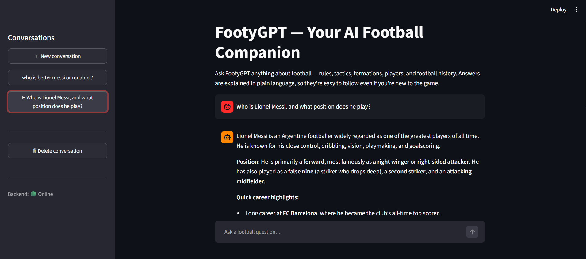

# ⚽ FootyGPT — AI-Powered Football Companion

An AI-powered football companion that lets you explore the world of football through an interactive AI chatbot.

## 📝 About the Project

FootyGPT is an AI-powered football chatbot built to answer football-related questions through a conversational interface.

The project combines a Streamlit frontend, a FastAPI backend, an SQLite database, and AI integration through OpenRouter to provide an interactive football Q&A experience.

## ✨ Features

* ⚽ **Football Q&A:** Ask football-related questions and receive AI-generated responses.
* 🤖 **AI-Powered Chat:** Interact with the application through a conversational interface.
* 💬 **Conversation Management:** Manage conversations through the application's backend.
* 💾 **Persistent Storage:** Store conversation data using SQLite.
* 🔌 **REST API:** Backend endpoints built with FastAPI.
* 🧪 **Automated Testing:** Tests implemented using Pytest.

## 🛠️ Tech Stack

| Technology | Purpose                   |
| ---------- | ------------------------- |
| Python     | Core programming language |
| Streamlit  | Frontend user interface   |
| FastAPI    | Backend API               |
| SQLite     | Database                  |
| SQLAlchemy | Database interaction      |
| Pydantic   | Data validation           |
| OpenRouter | AI model integration      |
| Pytest     | Automated testing         |

## 📸 Project Screenshot

Here's a preview of the FootyGPT application.



## 🏗️ Project Structure

```text
FootyGPT/
│
├── backend/
│   ├── routes/
│   │   ├── chat.py
│   │   ├── conversations.py
│   │   └── health.py
│   │
│   ├── services/
│   │   ├── ai_service.py
│   │   └── prompts.py
│   │
│   ├── config.py
│   ├── crud.py
│   ├── database.py
│   ├── exceptions.py
│   ├── main.py
│   ├── models.py
│   └── schemas.py
│
├── frontend/
│   ├── api_client.py
│   └── app.py
│
├── tests/
│
├── screenshots/
│   └── footygpt.png
│
├── .env.example
├── .gitignore
├── design.md
├── pytest.ini
├── requirements.txt
└── README.md
```

## ⚙️ Installation and Setup

Follow these steps to run FootyGPT locally.

### 1. Prerequisites

Install the following:

* Python
* Git

You'll also need an OpenRouter API key with sufficient credits to use your selected AI model.

### 2. Clone the Repository

Open your terminal and run:

```bash
git clone https://github.com/sanskaar82/FootyGPT.git
cd FootyGPT
```

### 3. Create a Virtual Environment

```powershell
python -m venv .venv
```

### 4. Activate the Virtual Environment

On Windows PowerShell:

```powershell
.\.venv\Scripts\Activate.ps1
```

### 5. Install Dependencies

```powershell
pip install -r requirements.txt
```

### 6. Configure Environment Variables

Create a `.env` file in the project's root directory, using `.env.example` as a reference.

Add your own OpenRouter API key and configure the AI model according to the variables expected by the application.

**Security note:** Never commit your `.env` file or publish your API key. Keep your credentials private.

### 7. Start the Backend

Run the following command in your first terminal:

```powershell
uvicorn backend.main:app --reload --host 127.0.0.1 --port 8000
```

The FastAPI backend will run locally on port `8000`.

You can access the interactive API documentation at:

http://127.0.0.1:8000/docs

### 8. Start the Frontend

Open a second terminal in the project directory and activate the virtual environment.

Run:

```powershell
streamlit run frontend/app.py
```

Open the local URL displayed in the terminal to access FootyGPT.


**Built with Python and a passion for football. ⚽**
