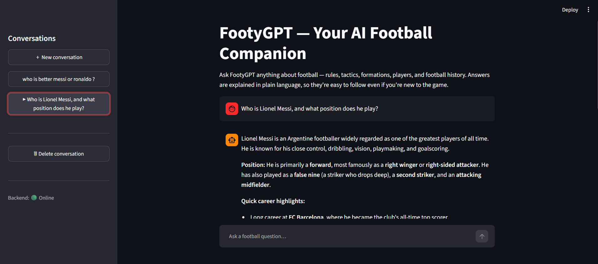

# ⚽ FootyGPT — AI-Powered Football Companion

An AI-powered football companion that lets you explore the world of football through an interactive AI chatbot.

## 📝 About the Project

FootyGPT is an AI-powered football chatbot built to answer football-related questions through a conversational interface.

The project combines a Streamlit frontend, a FastAPI backend, an SQLite database, and AI integration through OpenRouter to provide an interactive football Q&A experience.

## ✨ Features

* ⚽ **Football Q&A:** Ask football-related questions and receive AI-generated responses.
* 🤖 **AI-Powered Chat:** Interact with the application through a conversational interface.
* 💬 **Conversation Management:** Manage conversations through the application's backend.
* 💾 **Persistent Storage:** Store conversation data using SQLite.
* 🔌 **REST API:** Backend endpoints built with FastAPI.
* 🧪 **Automated Testing:** Tests implemented using Pytest.

## 🛠️ Tech Stack

| Technology | Purpose                   |
| ---------- | ------------------------- |
| Python     | Core programming language |
| Streamlit  | Frontend user interface   |
| FastAPI    | Backend API               |
| SQLite     | Database                  |
| SQLAlchemy | Database interaction      |
| Pydantic   | Data validation           |
| OpenRouter | AI model integration      |
| Pytest     | Automated testing         |

## 📸 Project Screenshot

Here's a preview of the FootyGPT application.



## 🏗️ Project Structure

```text
FootyGPT/
│
├── backend/
│   ├── routes/
│   │   ├── chat.py
│   │   ├── conversations.py
│   │   └── health.py
│   │
│   ├── services/
│   │   ├── ai_service.py
│   │   └── prompts.py
│   │
│   ├── config.py
│   ├── crud.py
│   ├── database.py
│   ├── exceptions.py
│   ├── main.py
│   ├── models.py
│   └── schemas.py
│
├── frontend/
│   ├── api_client.py
│   └── app.py
│
├── tests/
│
├── screenshots/
│   └── footygpt.png
│
├── .env.example
├── .gitignore
├── design.md
├── pytest.ini
├── requirements.txt
└── README.md
```

## ⚙️ Installation and Setup

Follow these steps to run FootyGPT locally.

### 1. Prerequisites

Install the following:

* Python
* Git

You'll also need an OpenRouter API key with sufficient credits to use your selected AI model.

### 2. Clone the Repository

Open your terminal and run:

```bash
git clone https://github.com/sanskaar82/FootyGPT.git
cd FootyGPT
```

### 3. Create a Virtual Environment

```powershell
python -m venv .venv
```

### 4. Activate the Virtual Environment

On Windows PowerShell:

```powershell
.\.venv\Scripts\Activate.ps1
```

### 5. Install Dependencies

```powershell
pip install -r requirements.txt
```

### 6. Configure Environment Variables

Create a `.env` file in the project's root directory, using `.env.example` as a reference.

Add your own OpenRouter API key and configure the AI model according to the variables expected by the application.

**Security note:** Never commit your `.env` file or publish your API key. Keep your credentials private.

### LangSmith Observability (optional)

FootyGPT integrates with [LangSmith](https://smith.langchain.com) for LLM observability.
Tracing is **disabled by default** and the backend works normally without any
LangSmith credentials.

To enable tracing:

1. Create a LangSmith account at https://smith.langchain.com and obtain an API key.
2. Add the following to your `.env` file:

   ```
   LANGSMITH_TRACING=true
   LANGSMITH_API_KEY=your-langsmith-api-key-here
   LANGSMITH_PROJECT=FootyGPT
   ```

3. Restart the backend. Each AI request will be traced with provider, model,
   input messages, response, latency, success/failure status, and token usage
   (when reported by the provider).

No API keys or authorization headers are ever captured in traces.

### Free-Tier Model Configuration

FootyGPT supports free-tier AI models from both OpenRouter and Google Gemini.
Free tiers have rate limits and token quotas; they are not unlimited.

#### Google Gemini

1. Obtain a Gemini API key at https://aistudio.google.com/app/apikey.
2. Select a free-tier model. Verify current free models and rate limits at
   https://ai.google.dev/pricing before selecting one.
3. Configure your `.env`:

   ```
   AI_PROVIDER=gemini
   GEMINI_API_KEY=your-gemini-api-key-here
   GEMINI_MODEL=gemini-1.5-flash
   ```

`gemini-1.5-flash` is an example free-tier model; model availability changes
over time. Always check Google's official documentation before deploying.

#### OpenRouter

1. Obtain an OpenRouter API key at https://openrouter.ai/keys.
2. Select a model. OpenRouter free models use the `:free` suffix, e.g.
   `openrouter/free` or `meta-llama/llama-3.1-8b-instruct:free`. Verify
   current free models at https://openrouter.ai/models.
3. Configure your `.env`:

   ```
   AI_PROVIDER=openrouter
   OPENROUTER_API_KEY=your-openrouter-api-key-here
   OPENROUTER_MODEL=openrouter/free
   ```

#### Switching Providers

Set `AI_PROVIDER` to `openrouter` or `gemini` in your `.env`. Only the
selected provider's API key and model are required; the other provider's
settings are ignored.

#### Automatic Provider Fallback

FootyGPT can automatically fall back to a secondary AI provider when the
primary provider encounters a temporary failure (rate limit, timeout, or
server error). Fallback is **disabled by default** and must be explicitly
configured.

**How it works:**

1. The primary provider is selected by `AI_PROVIDER`.
2. Optionally, set `AI_FALLBACK_PROVIDER` to the secondary provider.
3. If the primary raises a retryable error, the fallback provider is
   attempted **once**.
4. If the fallback also fails, the original primary exception is raised.
5. If fallback is not configured, or the fallback provider lacks valid
   credentials, the primary exception is raised immediately.

**Fallback is triggered for:**
- `AIRateLimitError` (HTTP 429)
- `AITimeoutError` (request timeout)
- `AIProviderError` with retryable server errors (HTTP 5xx)

**Fallback is NOT triggered for:**
- `AIConfigError` (missing or invalid API key, missing model)
- Non-retryable provider errors (malformed responses, empty responses,
  safety-blocked responses)

**Configuration examples:**

Gemini primary with OpenRouter fallback:
```
AI_PROVIDER=gemini
AI_FALLBACK_PROVIDER=openrouter
GEMINI_API_KEY=your-gemini-api-key-here
GEMINI_MODEL=gemini-1.5-flash
OPENROUTER_API_KEY=your-openrouter-api-key-here
OPENROUTER_MODEL=openrouter/free
```

OpenRouter primary with Gemini fallback:
```
AI_PROVIDER=openrouter
AI_FALLBACK_PROVIDER=gemini
OPENROUTER_API_KEY=your-openrouter-api-key-here
OPENROUTER_MODEL=openrouter/free
GEMINI_API_KEY=your-gemini-api-key-here
GEMINI_MODEL=gemini-1.5-flash
```

Disable fallback:
```
AI_PROVIDER=gemini
AI_FALLBACK_PROVIDER=
```

**Cost warning:** Fallback requests can incur additional charges depending
on the selected model and provider. Fallback is permitted only when
explicitly configured; it never silently switches to a paid model.

#### Managing Free-Tier Usage

To reduce token consumption and stay within free-tier limits:

- **`AI_MAX_TOKENS`** — caps the maximum output tokens per response (default: 800).
- **`AI_MAX_HISTORY_MESSAGES`** — limits how many previous messages are sent
  as context (default: 10).
- **`AI_TEMPERATURE`** — lower values produce more deterministic, shorter
  responses (default: 0.3).

Reducing `AI_MAX_HISTORY_MESSAGES` and `AI_MAX_TOKENS` is the most effective
way to manage free-tier token usage.

#### Rate Limits and Errors

When a provider returns HTTP 429 (rate limit), FootyGPT returns a
`429 Too Many Requests` response with a friendly message. If automatic
fallback is configured (`AI_FALLBACK_PROVIDER`), a rate limit from the
primary provider triggers a fallback attempt instead. Otherwise, wait
briefly and try again.

Avoiding unexpected charges:

- Verify that your selected model is actually free-tier before configuring it.
- Paid models can incur charges even on free accounts if you exceed quotas.
- Monitor your provider's dashboard for usage and billing.
- Enabling fallback may result in charges from both providers for a single
  request if the primary is rate-limited.

### 7. Start the Backend

Run the following command in your first terminal:

```powershell
uvicorn backend.main:app --reload --host 127.0.0.1 --port 8000
```

The FastAPI backend will run locally on port `8000`.

You can access the interactive API documentation at:

http://127.0.0.1:8000/docs

### 8. Start the Frontend

Open a second terminal in the project directory and activate the virtual environment.

Run:

```powershell
streamlit run frontend/app.py
```

Open the local URL displayed in the terminal to access FootyGPT.


**Built with Python and a passion for Football.**
